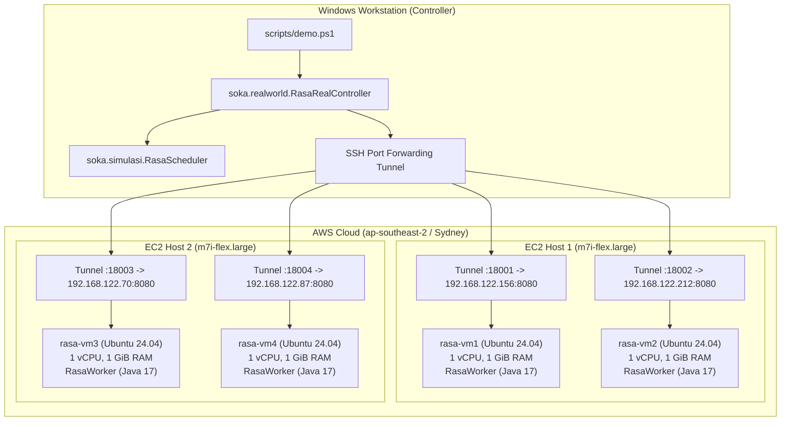

# Arsitektur Implementasi Real-World RASA di AWS

## 1. Ikhtisar Sistem

Implementasi ini mentransformasikan algoritma penjadwalan komputasi awan **Resource Aware Scheduling Algorithm (RASA)** dari lingkungan simulasi CloudSim menjadi eksekusi nyata (*real-world*) di atas infrastruktur Amazon Web Services (AWS).

---

## 2. Spesifikasi Topologi Infrastruktur

| Komponen | Identitas | Spesifikasi Virtual/Fisik | Peran |
|---|---|---|---|
| **Cloud Provider** | AWS (`ap-southeast-2`) | 1 Datacenter Logis (`ap-southeast-2a`) | Lingkungan Hosting |
| **EC2 Host 1** | `rasa-host-1` | `m7i-flex.large` (2 vCPU, 8 GiB RAM, KVM/libvirt) | Hypervisor Host 1 |
| **EC2 Host 2** | `rasa-host-2` | `m7i-flex.large` (2 vCPU, 8 GiB RAM, KVM/libvirt) | Hypervisor Host 2 |
| **Guest VM 1** | `rasa-vm1` | 1 vCPU, 1 GiB RAM, `192.168.122.156` (Host 1) | Compute Worker 1 |
| **Guest VM 2** | `rasa-vm2` | 1 vCPU, 1 GiB RAM, `192.168.122.212` (Host 1) | Compute Worker 2 |
| **Guest VM 3** | `rasa-vm3` | 1 vCPU, 1 GiB RAM, `192.168.122.70` (Host 2) | Compute Worker 3 |
| **Guest VM 4** | `rasa-vm4` | 1 vCPU, 1 GiB RAM, `192.168.122.87` (Host 2) | Compute Worker 4 |

---

## 3. Komponen Perangkat Lunak

### 3.1 Controller Penjadwalan (`RasaRealController.java`)
* Menginisialisasi preflight check ke semua worker endpoint.
* Menjalankan kalibrasi iterasi SHA-256 per detik (*measured IPS*) per VM.
* Membaca task dari dataset Google Cloud Jobs (`dataset/GoCJ_Dataset_<tasks>.txt`, skala 100 s.d. 500 task).
* Memanggil fungsi inti `soka.simulasi.RasaScheduler.schedule(taskLengths, vmMips, Mode.RASA)`.
* Mendispatch task via HTTP REST POST ke worker yang ditentukan.
* Menghitung makespan aktual, Degree of Imbalance (DI), average duration, dan throughput.

### 3.2 Worker Agent (`RasaWorker.java`)
* Service HTTP berbasis pustaka standar Java (`com.sun.net.httpserver.HttpServer`).
* Dikelola sebagai `systemd service` (`rasa-worker.service`) dengan auto-restart.
* Otentikasi menggunakan header `Authorization: Bearer <token>`.
* Mengontrol konkurensi core menggunakan `Semaphore(slots)`.
* Menjalankan beban komputasi nyata `CpuWorkload.java` (iterasi SHA-256).

### 3.3 Engine Komputasi CPU (`CpuWorkload.java`)
* Eksekusi komputasi deterministik murni CPU (bukan timer atau sleep).
* Mengukur durasi wall-clock (`System.nanoTime()`) dan CPU thread time (`ThreadMXBean`).
* Mengembalikan *hex checksum* 32-byte untuk verifikasi integritas eksekusi.

---

## 4. Keamanan dan Pola Jaringan

1. **Isolasi Subnet NAT Libvirt:**
   * Setiap VM guest beroperasi dalam bridge NAT privat `virbr0` (`192.168.122.0/24`).
   * Port 8080 pada VM tidak pernah dibuka ke internet publik (`0.0.0.0/0`).
2. **SSH Port Forwarding Encrypted Tunnel:**
   * Script demo membuka SSH Tunnel di latar belakang menggunakan OpenSSH Client dengan key AWS EC2 resmi.
   * Lalu lintas dari controller laptop ke VM guest dienkripsi penuh melalui tunnel SSH host parent.
3. **Pembersihan Otomatis (Automatic Teardown):**
   * Script `scripts/demo.ps1` memiliki blok `finally` yang menjamin seluruh proses background tunnel dihentikan saat eksperimen tuntas atau diinterupsi.

