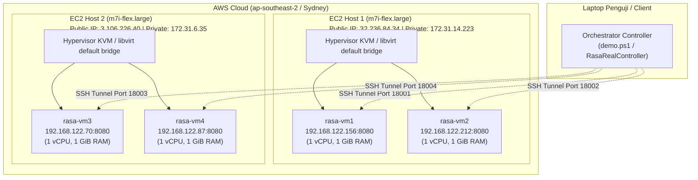

# Spesifikasi Infrastruktur Cloud Real-World (AWS)

Dokumen ini memuat arsitektur dan spesifikasi infrastruktur komputasi awan yang digunakan pada implementasi algoritma **Resource Aware Scheduling Algorithm (RASA)** untuk tugas mata kuliah Strategi Optimasi Komputasi Awan (SOKA).

---

## 1. Topologi Multi-Host & Guest VM

Topologi dirancang menggunakan **2 EC2 Host** di AWS Region Sydney (`ap-southeast-2`), di mana masing-masing host menjalankan **2 Virtual Machine (VM) guest** berbasis kernel hypervisor KVM/QEMU.

---

## 2. Rincian Spesifikasi Perangkat Keras & Virtualisasi

### A. Host Hypervisor (AWS EC2)

| Parameter | Host 1 (`rasa-host-1`) | Host 2 (`rasa-host-2`) |
| :--- | :--- | :--- |
| **Instance Type** | `m7i-flex.large` | `m7i-flex.large` |
| **Arsitektur CPU** | Intel Xeon Scalable Generasi ke-4 (Sapphire Rapids) | Intel Xeon Scalable Generasi ke-4 (Sapphire Rapids) |
| **Kapasitas CPU Host** | 2 vCPU | 2 vCPU |
| **Memori Host** | 8 GiB RAM | 8 GiB RAM |
| **Sistem Operasi** | Ubuntu Server 26.04.1 LTS | Ubuntu Server 26.04.1 LTS |
| **Virtualisasi** | KVM / QEMU (Nested Virtualization aktif) | KVM / QEMU (Nested Virtualization aktif) |
| **Jaringan Virtual** | `virbr0` (NAT libvirt, subnet `192.168.122.0/24`) | `virbr0` (NAT libvirt, subnet `192.168.122.0/24`) |
| **IP Publik Terakhir** | `32.236.84.34` | `3.106.226.40` |
| **IP Privat VPC** | `172.31.14.223` | `172.31.6.35` |

---

### B. Worker Compute Nodes (KVM Guest VMs)

| VM Node | Host Induk | IP Privat Guest | Alokasi vCPU | Alokasi RAM | Format Disk | Service Daemon |
| :--- | :--- | :--- | :---: | :---: | :---: | :--- |
| **`rasa-vm1`** | Host 1 | `192.168.122.156` | 1 vCPU | 1 GiB | 4 GiB qcow2 | `rasa-worker.service` (:8080) |
| **`rasa-vm2`** | Host 1 | `192.168.122.212` | 1 vCPU | 1 GiB | 4 GiB qcow2 | `rasa-worker.service` (:8080) |
| **`rasa-vm3`** | Host 2 | `192.168.122.70` | 1 vCPU | 1 GiB | 4 GiB qcow2 | `rasa-worker.service` (:8080) |
| **`rasa-vm4`** | Host 2 | `192.168.122.87` | 1 vCPU | 1 GiB | 4 GiB qcow2 | `rasa-worker.service` (:8080) |

Setiap VM guest menggunakan sistem operasi **Ubuntu Server 24.04 LTS** (cloud image) dengan runtime **OpenJDK 17 Headless**.

---

## 3. Pemetaan Port Jaringan (Port Forwarding & API)

Controller berkomunikasi secara aman melalui SSH Local Port Forwarding yang dibuka otomatis oleh script demo:

| Endpoint Lokal Controller | Target Jaringan di AWS | Tujuan Worker VM | Fungsi |
| :---: | :---: | :---: | :--- |
| `http://127.0.0.1:18001` | Host 1 $\rightarrow$ `192.168.122.156:8080` | `rasa-vm1` | Health check & eksekusi task |
| `http://127.0.0.1:18002` | Host 1 $\rightarrow$ `192.168.122.212:8080` | `rasa-vm2` | Health check & eksekusi task |
| `http://127.0.0.1:18003` | Host 2 $\rightarrow$ `192.168.122.70:8080` | `rasa-vm3` | Health check & eksekusi task |
| `http://127.0.0.1:18004` | Host 2 $\rightarrow$ `192.168.122.87:8080` | `rasa-vm4` | Health check & eksekusi task |

---

## 4. Keamanan & Kebijakan Publikasi GitHub

Dokumen ini **100% aman untuk di-push ke GitHub** publik maupun privat:
1. **Tidak Ada Kredensial Rahasia:** File private key (`*.pem`), SSH passphrase, dan token otentikasi worker tidak pernah dicantumkan pada file ini dan selalu diproteksi oleh file `.gitignore`.
2. **Subnet Privat RFC-1918:** Alamat IP `192.168.122.x` dan `172.31.x.x` adalah alamat jaringan internal lokal yang tidak dapat diakses secara langsung dari internet terbuka tanpa kredensial SSH.
3. **Reproducibility:** Struktur spesifikasi di atas memudahkan dosen penilai maupun anggota kelompok lain untuk memahami konfigurasi mesin tanpa risiko keamanan.

